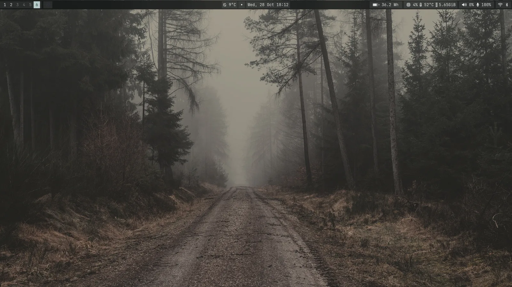
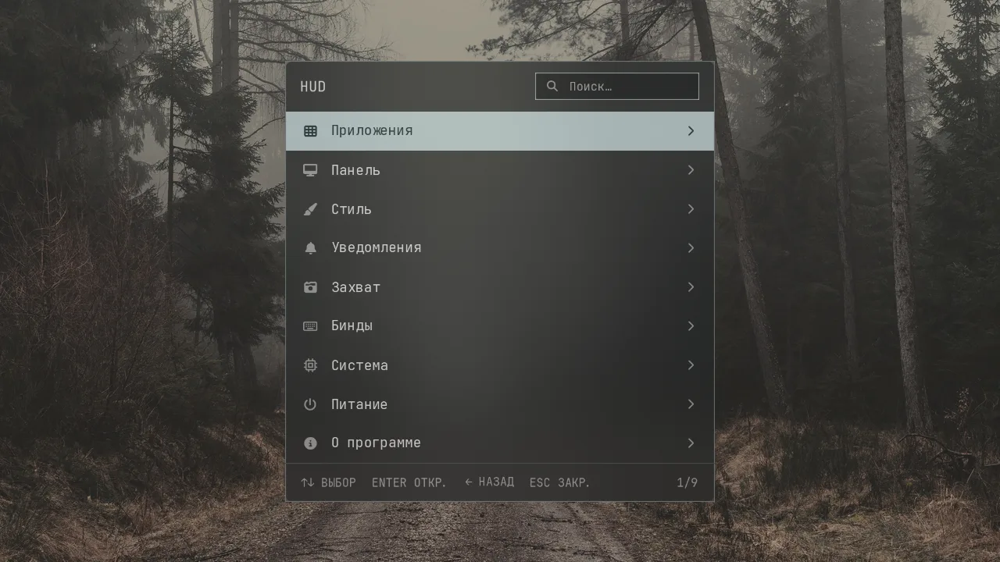
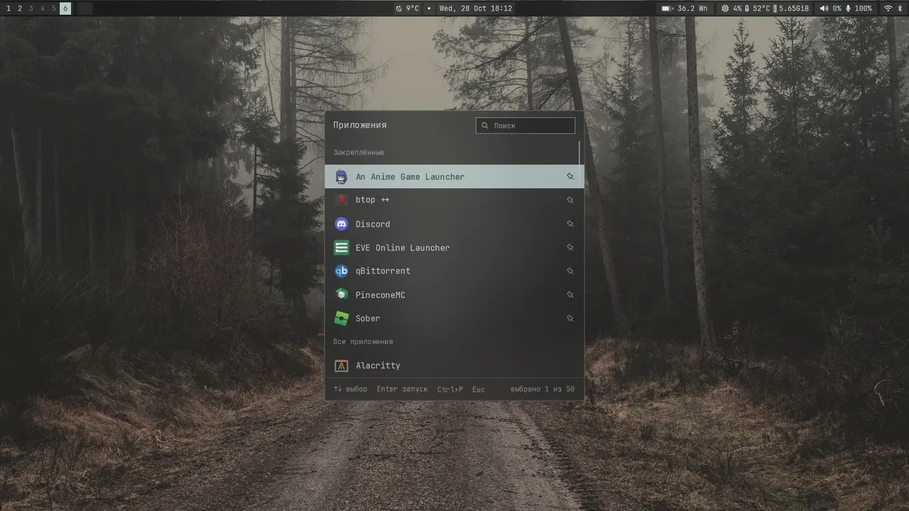
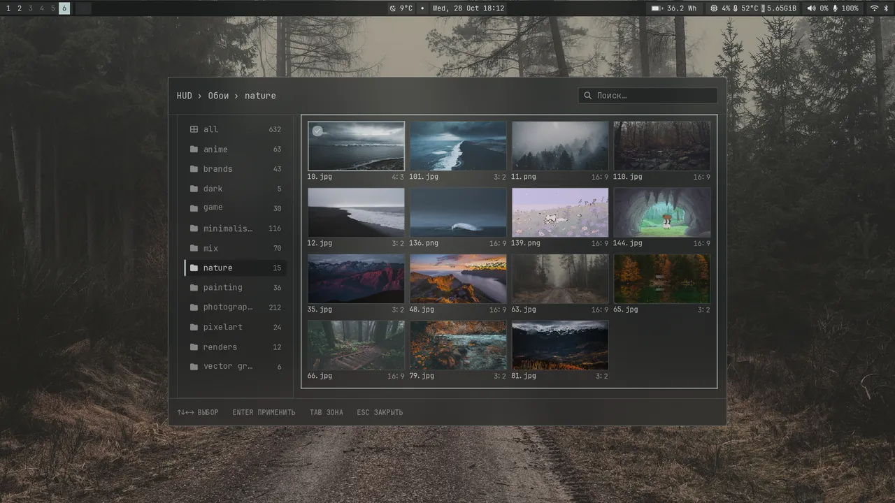
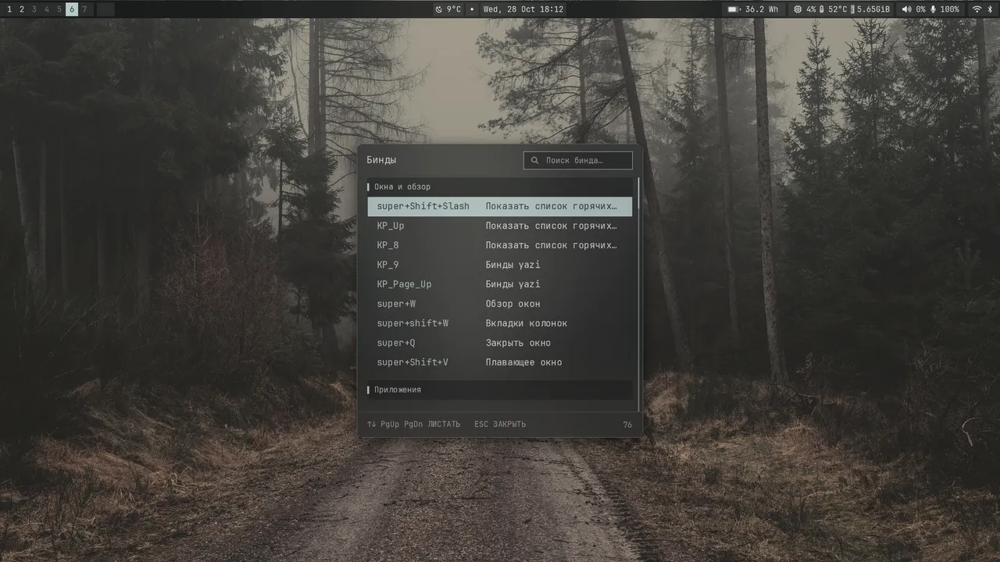
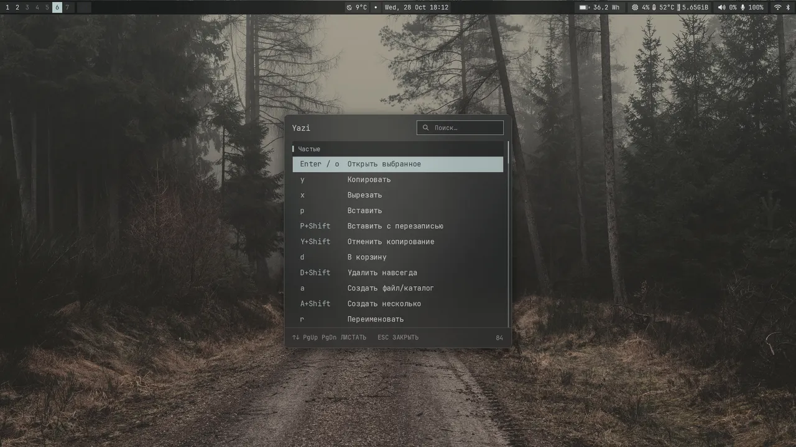
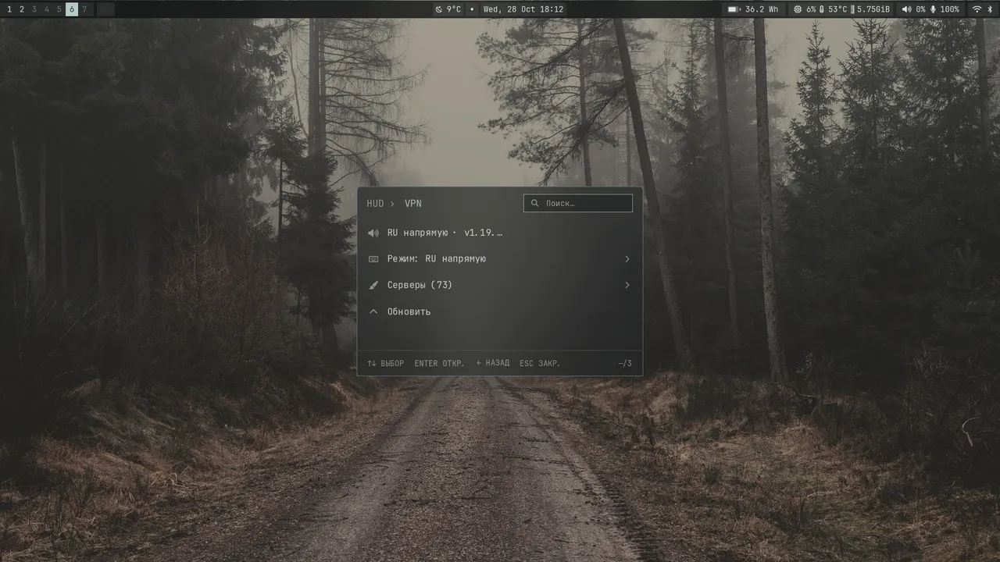

<div align="center">

# HUDbar

**Верхняя панель и HUD-окна для [niri](https://github.com/YaLTeR/niri) на Wayland.**

Каждый кадр рисуется в `wl_shm` через [tiny-skia](https://github.com/RazrFalcon/tiny-skia):
без GTK, без виджетов и без лишних процессов.

[](https://github.com/Misha254/Hudbar/actions/workflows/ci.yml)
[](https://github.com/Misha254/Hudbar/releases)


</div>

[](assets/screens/overview.webp)

## Возможности

- **Панель.** Рабочие столы niri, часы, погода, батарея, CPU и температура, память,
  громкость и микрофон, Wi-Fi, Bluetooth, трей, запись экрана и DND.
- **OSD.** Громкость, микрофон и яркость — своё окно вместо уведомлений dunst.
- **Меню HUD** (`Super+Alt+Space`). Разделы настроек, тумблеры, системные действия и поиск;
  окно плавно меняет высоту при входе в подменю и выходе из него.
- **Лаунчер** (`Super+D`). Закреплённые приложения, поиск и иконки SVG/PNG — без rofi и X11.
- **Обои** (`Super+Z`). Папки, превью и применение без перезапуска сессии.
- **Бинды** (`Super+Shift+Slash`, `KP_9`). Нативные окна для niri и yazi вместо Rofi-скриптов.
- **VPN** (`KP_7`). Режимы и серверы Mihomo в том же стиле, что и остальные окна.
- **Цвета matugen.** `colors.css` перечитывается на лету: тема меняется без перезапуска панели.
- **Анимации.** Открытие, ховер и высота меню уважают `animations` и `animation_speed`;
  при выключенных анимациях всё применяется сразу.

## Скриншоты

<table>
  <tr>
    <td width="50%" align="center">
      <a href="assets/screens/menu-panel.webp"></a><br>
      <sub><b>Меню</b> — разделы, поиск, подсказки</sub>
    </td>
    <td width="50%" align="center">
      <a href="assets/screens/launcher.webp"></a><br>
      <sub><b>Лаунчер</b> — закреплённые, поиск, Enter</sub>
    </td>
  </tr>
  <tr>
    <td width="50%" align="center">
      <a href="assets/screens/wallpapers.webp"></a><br>
      <sub><b>Обои</b> — папки, сетка превью, применение</sub>
    </td>
    <td width="50%" align="center">
      <a href="assets/screens/binds-niri.webp"></a><br>
      <sub><b>Бинды niri</b> — группы и поиск</sub>
    </td>
  </tr>
  <tr>
    <td width="50%" align="center">
      <a href="assets/screens/binds-yazi.webp"></a><br>
      <sub><b>Бинды yazi</b> — те же клавиши, что в редакторе</sub>
    </td>
    <td width="50%" align="center">
      <a href="assets/screens/vpn-menu.webp"></a><br>
      <sub><b>VPN</b> — режим, серверы, обновление</sub>
    </td>
  </tr>
</table>

## Установка

```bash
git clone https://github.com/Misha254/Hudbar.git
cd Hudbar
./install.sh --dry-run
./install.sh
```

Установщик не перезаписывает существующие файлы без `--force`, а перед заменой кладёт
резервную копию в `~/.local/state/hudbar/backups/`. Конфигурацию niri, rofi и dunst он
не трогает.

Для Arch Linux есть пакет:

```bash
cd packaging && makepkg -si
```

Он ставит бинарники в `/usr/bin`, а файлы по умолчанию — в `/usr/share/hudbar`. Настройки
копируются в `~/.config/hudbar` вручную, напоминание печатает сам пакет.

### Из исходников

```bash
cargo build --release
install -m 755 target/release/hudbar ~/.local/bin/hudbar
pkill -x hudbar; hudbar &
```

Для полного набора функций нужны `niri`, `nmcli`, `bluetoothctl`, `wpctl`/`pactl` и `awww`.
Без них панель запускается, но соответствующие чипы остаются пустыми. Шрифт по умолчанию —
`JetBrainsMono Nerd Font Propo`, свой можно положить в `~/.config/hudbar/font`.

## Настройка

Всё лежит в `~/.config/hudbar/`:

| Файл | Что задаёт |
| --- | --- |
| `settings.json` | чипы панели, вид, уведомления, OSD, VPN |
| `settings.schema.json` | подсказки и проверка `settings.json` в редакторе |
| `colors.css` | палитра из шести цветов, формат matugen |
| `font` | имя шрифта интерфейса |
| `apps-pinned` | закреплённые приложения лаунчера |

Ключи, диапазоны и значения по умолчанию описаны в
[`docs/settings.schema.json`](docs/settings.schema.json). Изменения `settings.json` и
`colors.css` подхватываются автоматически; `height` панели обновляет её размер и exclusive zone.

## Документация

- [Архитектура](docs/ARCHITECTURE.md) — кадр, карта файлов, типичные правки.
- [Компоненты](docs/COMPONENTS.md) — какой бинарник за что отвечает.
- [Меню niri](docs/niri-menu.md) и [обои](docs/wallpaper.md) — подробности окон.
- [ROADMAP](docs/ROADMAP.md) — что сделано и что дальше.
- [Дизайн](docs/design/) — макеты и референсы.

## Проверка

```bash
cargo fmt --check
cargo test
cargo clippy --all-targets -- -D warnings
```

---

Собрано на [smithay-client-toolkit](https://github.com/Smithay/client-toolkit),
[cosmic-text](https://github.com/pop-os/cosmic-text), [tiny-skia](https://github.com/RazrFalcon/tiny-skia)
и [resvg](https://github.com/linebender/resvg).
